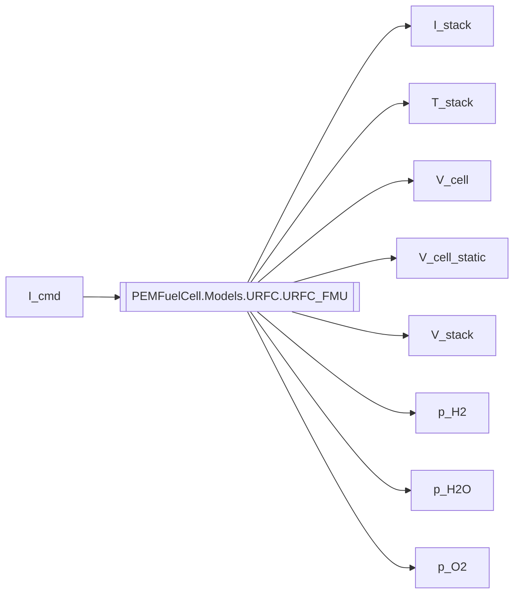

The progress of modelling an open and scalable Unitized Reversible Fuel cell can be found on this page. The work was committed as a partial fulfillment of a bachelor's thesis. All data used, obtained and script for analysis can be found on this page. 

The Python code for designing figures and aligning data can be found in "Python code".
The modeling process in Openmodelica can be found in "Openmodelica Code". Note that not all code is functional at this point as it was not all used for data gain, which is something I hope to fix in the future.

The final model was exported as a Functional Mockup Unit, which is visualized in this image:

